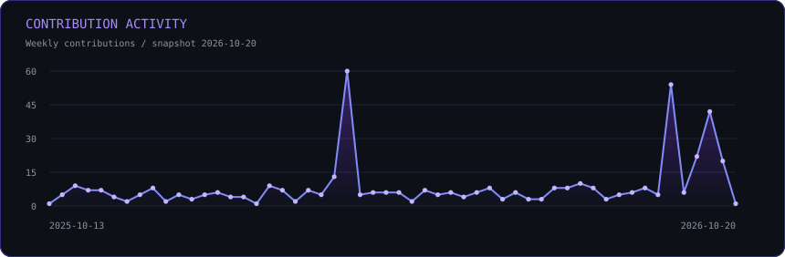
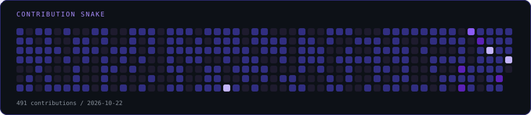

<div align="center">

<a href="./README.md"></a>
<a href="./README.fr.md"></a>

<br /><br />

<a href="https://portfolio-peach-eight-80.vercel.app/">
  
</a>

<a href="https://github.com/Echaimi">
  
</a>

<br />

<a href="https://www.esgi.fr/"></a>
<a href="https://portfolio-peach-eight-80.vercel.app/"></a>
<a href="https://portfolio-peach-eight-80.vercel.app/"></a>

<br /><br />

<a href="https://portfolio-peach-eight-80.vercel.app/"></a>
<a href="https://www.linkedin.com/in/elyas-chaimi/"></a>
<a href="mailto:elyaschaimi@gmail.com"></a>
<a href="https://github.com/Echaimi"></a>

<br /><br />

<a href="https://github.com/Echaimi"></a>
<a href="https://github.com/Echaimi?tab=followers"></a>
<a href="https://github.com/Echaimi?tab=repositories"></a>

</div>

---

## About

I'm **Elyas Chaimi**, a full stack developer based in **Paris**, with **5+ years of experience** across e-commerce, fintech and SaaS.

I build products from **interface to infrastructure**: React applications, design systems, REST APIs, Node.js microservices and deployment pipelines. My experience includes modernizing a legacy PHP monolith, rebuilding customer journeys and developing investment dashboards.

Today, I focus on **applied AI and retrieval-augmented generation**. With **RepoSage**, **ShopMind** and **Confluo**, I work on AST-aware chunking, hybrid search, reranking and answers grounded in explicit source citations.

My product engineering approach is straightforward: understand the user journey, define clear contracts and carry the implementation through the frontend, backend and infrastructure.

**Education:** Master's in Web Engineering · ESGI<br />
**Languages:** French · Arabic · English — TOEIC 920 · Spanish

### Open To

**Full stack engineering · Applied AI / RAG engineering · Product development · Technical collaboration**

[Discuss a role or a product](mailto:elyaschaimi@gmail.com) · [Explore my portfolio](https://portfolio-peach-eight-80.vercel.app/)

---

## Tech Stack

### Languages

<p align="center">
  <a href="https://skillicons.dev"></a>
</p>

### Frontend

<p align="center">
  <a href="https://skillicons.dev"></a>
</p>

<p align="center"><a href="https://portfolio-peach-eight-80.vercel.app/"></a> <a href="https://portfolio-peach-eight-80.vercel.app/"></a></p>

### Backend & Databases

<p align="center">
  <a href="https://skillicons.dev"></a>
</p>

### Cloud, DevOps & Tooling

<p align="center">
  <a href="https://skillicons.dev"></a>
</p>

<p align="center"><a href="https://portfolio-peach-eight-80.vercel.app/"></a> <a href="https://portfolio-peach-eight-80.vercel.app/"></a> <a href="https://portfolio-peach-eight-80.vercel.app/"></a> <a href="https://portfolio-peach-eight-80.vercel.app/"></a></p>

---

## AI / ML Expertise

My AI work focuses on **LLM application engineering, retrieval and grounded generation**.

| Domain | Proficiency | Details |
| :--- | :--- | :--- |
| RAG | Applied projects | Assistants for repository code, product catalogs and documents |
| Hybrid retrieval | Applied projects | Semantic vector search + keyword retrieval, including BM25 |
| Code understanding | RepoSage | Tree-sitter AST parsing; chunking by function, class and module |
| Reranking | Confluo | Cohere Rerank |
| Ingestion pipelines | Confluo | Notion · Slack · Markdown · PDF |
| Grounded generation | Applied projects | File, line and passage citations; fallback when evidence is missing |
| Vector databases | Project stack | Weaviate · Pinecone · Qdrant |
| LLM application tooling | Project stack | LangChain.js · LlamaIndex.js · Vercel AI SDK |

<p align="center">
<a href="https://portfolio-peach-eight-80.vercel.app/"></a>
<a href="https://portfolio-peach-eight-80.vercel.app/"></a>
<a href="https://portfolio-peach-eight-80.vercel.app/"></a>
<a href="https://portfolio-peach-eight-80.vercel.app/"></a>
</p>

---

## Featured Projects

<details open>
<summary><strong>RepoSage — Repository Intelligence</strong></summary>

<br />

A GitHub repository assistant that answers code questions with **file and line citations**.

| Dimension | Details |
| :--- | :--- |
| **Stack** | TypeScript · Next.js · Tree-sitter · LangChain.js · LlamaIndex.js · Weaviate · Vercel AI SDK |
| **Scale** | JavaScript / TypeScript repositories; parsing extensible to Python and Go |
| **Performance** | AST-aware chunking, vector + BM25 retrieval and streaming answers |
| **Security** | Access-control design not specified in the public project summary |
| **Impact** | Connects answers to functions, classes, modules and source locations |
| **Repository** | [github.com/Echaimi/RepoSage](https://github.com/Echaimi/RepoSage) |

RepoSage preserves the structure of code during retrieval. Tree-sitter identifies meaningful syntax boundaries, hybrid search combines semantic intent with exact terms, and citations make each answer traceable to the repository.

</details>

<br />

<details>
<summary><strong>ShopMind — Grounded E-Commerce Assistant</strong></summary>

<br />

An e-commerce chatbot combining **product information, reviews and real-time stock**.

| Dimension | Details |
| :--- | :--- |
| **Stack** | Next.js · Vercel AI SDK · Pinecone · PostgreSQL |
| **Scale** | Product sheets, customer reviews and inventory information |
| **Performance** | Metadata filtering by price, category and availability |
| **Security** | Access-control design not specified in the public project summary |
| **Impact** | Source-cited review summaries and fallback when information is missing |
| **Repository** | [github.com/Echaimi/ShopMind](https://github.com/Echaimi/ShopMind) |

ShopMind grounds product answers in catalog and inventory information. Metadata filters narrow the relevant evidence, review summaries preserve their sources, and the assistant falls back when the available data cannot support an answer.

</details>

<br />

<details>
<summary><strong>Confluo — Multi-Source Knowledge Retrieval</strong></summary>

<br />

A search engine across **Notion, Slack, Markdown and PDF documents**.

| Dimension | Details |
| :--- | :--- |
| **Stack** | TypeScript · LangChain.js · LlamaIndex.js · Qdrant · Cohere Rerank · PostgreSQL |
| **Scale** | Four source types, each with a dedicated ingestion pipeline |
| **Performance** | Dense + sparse retrieval, reranking, deduplication and streaming |
| **Security** | Access-control design not specified in the public project summary |
| **Impact** | Passage-level citations across heterogeneous document sources |
| **Repository** | [github.com/Echaimi/Confluo](https://github.com/Echaimi/Confluo) |

Confluo brings scattered knowledge into one retrieval pipeline. Source-specific ingestion, hybrid search and Cohere reranking identify relevant passages; cross-source deduplication reduces repetition while citations preserve traceability.

</details>

---

## Experience

### Full Stack Developer · Generative AI / RAG Projects

**January 2026 — Present · Paris**

Building retrieval-based assistants for code, e-commerce and multi-source document search.

- Developed **RepoSage**, **ShopMind** and **Confluo**.
- Applied AST-based chunking, metadata filtering and source-specific ingestion.
- Combined semantic and keyword retrieval with reranking.
- Built streaming answer interfaces with citations and fallback behavior.

`TypeScript` `Next.js` `LangChain.js` `LlamaIndex.js` `Vercel AI SDK`

<br />

### Web Developer · Smallable

**November 2022 — January 2026 · Paris**

Worked across the frontend, backend and infrastructure of an international e-commerce concept store with approximately **750 brands**.

- Progressively decommissioned a legacy **PHP monolith** in favor of **Node.js microservices**.
- Migrated the frontend to **React**.
- Worked on the design system, customizable checkout, loyalty program and customer journey.
- Built REST APIs using **Express**, **NestJS** and **FastAPI**.
- Used **Elasticsearch**, **Docker**, **Kubernetes** and CI/CD for delivery.

`React` `Node.js` `FastAPI` `Express` `NestJS` `Elasticsearch` `Docker` `Kubernetes`

<br />

### Web Developer · Container de France

**January 2021 — November 2022 · Paris**

Contributed to the digital transformation of a French physical-market business, from interface design to production delivery.

- Rebuilt frontend, backend and server management foundations.
- Developed authentication and application interfaces.
- Refined the user journey through a visual redesign.
- Improved load performance and technical SEO.
- Introduced unit tests and CI/CD deployments.

`React` `PHP` `HTML` `CSS` `Unit Testing` `CI/CD`

<br />

### Full Stack Developer · TYLIA Invest

**September 2020 — January 2021 · Paris**

Developed interfaces and services for private-market investment platforms, including portfolio tracking and reporting.

- Built interactive investment and portfolio dashboards with **React**.
- Developed **Node.js microservices** for authentication, transactions and reporting.
- Worked with **PostgreSQL** and **MongoDB**.
- Added unit and integration tests, logging and monitoring.
- Contributed to server performance improvements within an Agile team.

`React` `Node.js` `PostgreSQL` `MongoDB` `Integration Testing` `Monitoring`

---

## Achievements

<div align="center">

| Recognition | Details |
| :--- | :--- |
| **Academic qualification** | Master's in Web Engineering · ESGI |
| **English assessment** | TOEIC **920** |
| **Professional experience** | 5+ years across e-commerce, fintech and SaaS |
| **Legacy modernization** | PHP monolith migration, React frontend and Node.js microservices at Smallable |
| **Applied AI portfolio** | RepoSage · ShopMind · Confluo |

</div>

---

## GitHub Analytics

<div align="center">

<a href="https://github.com/Echaimi"></a>
<a href="https://github.com/Echaimi?tab=repositories"></a>

<br /><br />

<a href="https://github.com/Echaimi"></a>

</div>

---

## GitHub Trophies

<div align="center">

<a href="https://github.com/Echaimi"></a>

</div>

---

## Contribution Activity

<div align="center">

<a href="https://github.com/Echaimi"></a>

</div>

---

## Contribution Snake

<div align="center">

<a href="https://github.com/Echaimi"></a>

</div>

---

## Current Focus

```yaml
Learning:
  - Retrieval strategies for code and documents
  - Grounded generation and source traceability

Building:
  - "RepoSage: code answers with file and line citations"
  - "ShopMind: product assistance grounded in catalog data"
  - "Confluo: multi-source knowledge retrieval"

Exploring:
  - AST-aware chunking
  - Hybrid semantic and keyword search
  - Reranking and cross-source deduplication
  - Streaming interfaces for LLM applications

Open To:
  - Full stack engineering
  - Applied AI and RAG engineering
  - Product development
  - Technical collaboration
```

---

## Connect

<div align="center">

<p>A product to build, a system to improve or a retrieval challenge to solve?<br /><strong>Let's discuss the engineering behind it.</strong></p>

<a href="mailto:elyaschaimi@gmail.com"></a>
<a href="https://www.linkedin.com/in/elyas-chaimi/"></a>
<a href="https://github.com/Echaimi"></a>
<a href="https://portfolio-peach-eight-80.vercel.app/"></a>

<br /><br />

[elyaschaimi@gmail.com](mailto:elyaschaimi@gmail.com)

</div>

---

<div align="center">

<em>“Build with clear intent, engineer with care, and make every answer traceable.”</em>

<br /><br />

<a href="https://portfolio-peach-eight-80.vercel.app/"></a>

</div>
